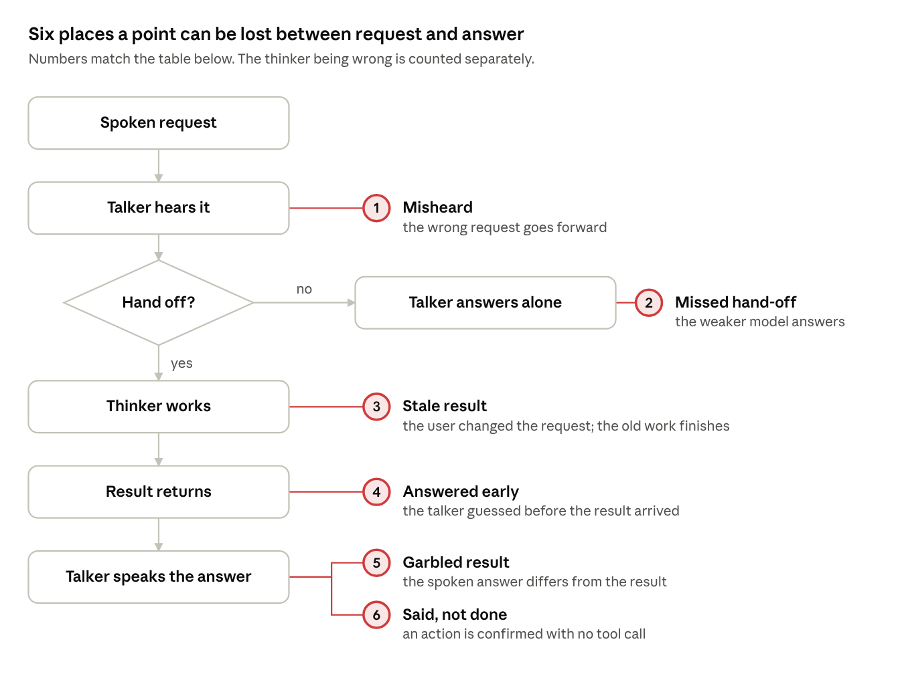
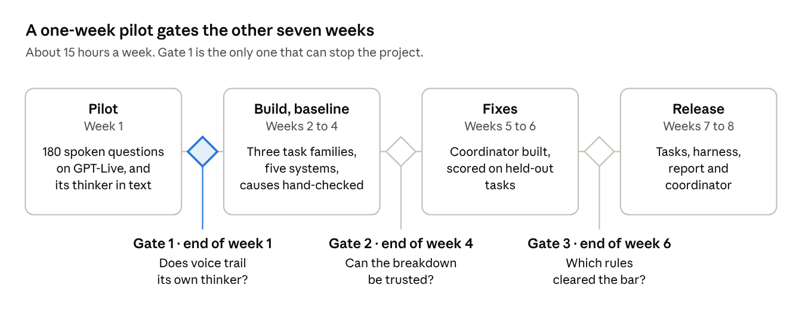

# Proposal: voice–text parity benchmark

Nov 13, 2026

_Public copy of the working proposal, exported on 2026-11-14. Internal planning sections are left out._

Measure, for every major voice system, how long a user waits for a right answer and how much of the system's own thinking model survives into speech. Where two models share the work, find where the rest is lost and build an open coordinator that wins it back.

Vendors now close the voice-versus-text gap by letting the system think, in four ways: a second model (OpenAI), a thinking setting (Google), a separate reasoning model (ElevenLabs), or a text model inside a pipeline (Anthropic). All four trade waiting for intelligence. The public leaderboard reports neither the wait for the answer nor the score against the system's own thinker, and a search found no published measurement of the hand-off.

The plan is about 8 weeks part-time. A one-week pilot decides whether to continue.

## Why this direction

The gap between voice and text has narrowed wherever a system is allowed to think, and what that thinking costs in waiting and coordination is not being measured.

| System | Spoken reasoning (Big Bench Audio) | Agent tasks (τ-Voice) | Time to first audio |
| --- | --- | --- | --- |
| Gemini 3.8 Live | 91.7% | 30.1% | 1.18 s |
| Gemini 3.8 Live, extended thinking | 97.7% | 68.6% | 1.35 s |
| GPT-Live-1 with a GPT-6 Astra backend | 90.1% | 74.5% (one trial) | 1.34 s |
| Eleven Realtime v1 Mini | 75.9% | 46.8% | 0.62 s |
| Eleven Realtime v1 Max | 98.8% | 47.6% | 0.57 s |
| Grok Voice 3.0 | 98.5% | 71.6% | 0.81 s |
| Phonic 1 (High) | 98.9% | 79.9% | 0.61 s |

These are from the [Artificial Analysis leaderboard](https://artificialanalysis.ai/speech-to-speech). For reference, a text agent on GPT-5 scored 85% on the same agent tasks in March 2026, per the [τ-Voice paper](https://arxiv.org/abs/2603.13686).

- **Spoken reasoning is nearly solved** once a system is allowed to think: thinking systems score 97–99%, fast ones 76–92%.
- **Agent work still trails text.** The best voice score is 79.9%, against 85% for a text agent eight months ago.
- **Reasoning does not guarantee agent work.** Eleven Realtime Max scores 98.8% on spoken reasoning and 47.6% on agent tasks.
- **Hearing is not the main loss.** Single-turn tool calling drops only [2 to 5 points](https://arxiv.org/abs/2605.15104) going from text to voice.
- **The published latency is time to first audio,** which a filler word satisfies. Max "reasons before it responds" yet posts a shorter time to first audio than Mini, which suggests the number is not the wait for an answer.

### Four designs, one trade

Each vendor lets its voice system think in a different way, and each leaves someone a decision about when to think.

| Design | Example | Who decides when to think |
| --- | --- | --- |
| Voice model plus backend model | OpenAI GPT-Live-1, which hands work to a reasoning backend | The voice model, guided by the builder's prompt |
| One voice model with a thinking setting | Google Gemini 3.8 Live, plain or extended thinking | The builder, once, by choosing the variant |
| A fast model and a reasoning model | [ElevenLabs Eleven Realtime v1 Mini and Max](https://elevenlabs.io/docs/eleven-agents/customization/realtime-models). Max "reasons before it responds", and Mini and Max agents can transfer to each other | The builder, by choosing the model or setting up transfers |
| A text model inside a pipeline | [Anthropic's Claude voice mode](https://support.claude.com/en/articles/11101966-use-voice-mode): speech is turned into text for the same Claude models as chat | The user, by picking Haiku, Sonnet or Opus. In the API, a fast model can consult a stronger one through the [advisor tool](https://platform.claude.com/docs/en/build-with-claude/overview) |

- **The pipeline is the mirror image of the speech-native designs.** It should keep the text model's intelligence, because the same model answers, and pay in waiting and conversation quality. That is an inference: no Claude system is on the leaderboard.
- **Anthropic's design may change.** In July 2026 it said it is ["continuing to invest in voice"](https://www.unite.ai/anthropic-brings-opus-and-sonnet-to-claude-voice-mode/), and the Claude API has no audio or realtime feature today.

### The hand-off is a live problem

GPT-Live's voice model decides when to pass work to its backend. OpenAI calls this delegation.

- **OpenAI leaves the decision to the builder.** Its [delegation guide](https://developers.openai.com/api/docs/guides/live-delegation) says to "use the live prompt to guide when it should delegate". Its [prompting guide](https://developers.openai.com/api/docs/guides/live-prompting) warns that "A spoken promise such as 'I'm checking that' does not confirm that backend work has started."
- **Builders are hitting it.** In [OpenAI's developer thread](https://community.openai.com/t/introducing-gpt-live-1-in-the-api/1396471) they report that "the frontend sometimes doesn't delegate when it should", that "the preambles get ahead of the backend", and that conversations stall during lookups.
- **One number fits.** GPT-Live-1 scores 90.1% on spoken reasoning with a frontier backend, below every other thinking system in the table. That is consistent with missed hand-offs. It is an inference to test, not a finding.
- **It was foreseen.** [VERA](https://arxiv.org/abs/2509.26542) found in 2025 that separating thinking from speaking raised accuracy but added grounding and consistency errors.

### What prior work covers

| Work | Covers | Leaves open |
| --- | --- | --- |
| [Artificial Analysis leaderboard](https://artificialanalysis.ai/speech-to-speech) | Spoken reasoning, agent tasks, time to first audio | The text ceiling for the same thinking model; time to the answer; why points are lost |
| [VERA](https://arxiv.org/abs/2509.26542) (2025) | Voice versus text reasoning inside model families | Today's shipped systems; a cause for each failure; fixes |
| [τ-Voice](https://arxiv.org/abs/2603.13686), [VAmoS](https://arxiv.org/abs/2607.27453), [Full-Duplex-Bench v3](https://arxiv.org/abs/2604.04847), [IHBench](https://arxiv.org/abs/2606.19595) | Task completion, say-versus-do checks, tool use on real disfluent speech, recovery after an interruption | Hand-off behaviour between a talker and a thinker |
| [Talker-Reasoner](https://arxiv.org/abs/2410.08328), [ConvFill](https://arxiv.org/abs/2511.07397), [VoiceAgentRAG](https://arxiv.org/abs/2603.02206), [a 2026 frontend-backend design](https://arxiv.org/abs/2609.19334) | Two-model designs, each tested on its own system | A measurement of hand-off quality across shipped systems |

This rests on about thirty searches, not a full literature review. The pilot week includes a proper one.

## What gets measured

Two scores lead the results and apply to every system: parity with the system's own thinker, and time to a right answer. The hand-off scores and the cause breakdown go deeper wherever a hand-off can be seen.

| Score | Definition | Applies to |
| --- | --- | --- |
| Text ceiling | The thinking model's score on the same tasks as text, with the same reasoning effort and tools | Every system |
| Voice score | The voice system's score on the same tasks, spoken | Every system |
| Parity | Voice score divided by text ceiling | Every system |
| Time to a right answer | Seconds from the end of the request to the start of the sentence that carries the answer, over the runs answered correctly. Filler does not count | Every system |
| Hand-off recall | Of tasks that need the thinker, the share handed off | Where a hand-off is visible |
| Hand-off precision | Of hand-offs made, the share that were needed | Where a hand-off is visible |
| Lost points by cause | Each task the thinker gets right in text and the voice system gets wrong, assigned to one cause below | In full where a hand-off is visible; causes 1 and 6 elsewhere |
| Distance from ideal | The gap to the best score and wait that perfect decisions about when to think would give | Every system with a fast and a thinking condition |

### Three conditions

Each system answers the reasoning tasks fast, thinking, and as shipped.

| System | Fast | Thinking | As shipped |
| --- | --- | --- | --- |
| GPT-Live-1 | Prompt says never hand off | Prompt says always hand off | OpenAI's recommended prompt |
| Gemini 3.8 Live | Plain model | Extended thinking | No mixed mode; both are reported |
| Eleven Realtime | Mini | Max | Mini, the default. Mini with transfer to Max, if the pilot shows it can be set up |
| Claude pipeline | Haiku alone | Opus alone | Haiku with an Opus advisor |
| gpt-6 pipeline | Fast talker alone | gpt-6-sol alone | Talker that hands off to gpt-6-sol |
| Phonic 1 | Lowest reasoning setting offered | Highest | Default |

- **Fast versus thinking** shows which tasks need the thinking. That defines recall and precision.
- **Thinking** shows what is lost even when the system always thinks: mishearing and garbled results.
- **The two together give the ideal:** thinking-level accuracy, with waiting only where it was needed.

### Where a point can be lost

The coordinator's four rules target causes 2 to 6. Cause 1 is a hearing error and is only measured.

| # | Cause | How it is detected |
| --- | --- | --- |
| 1 | Misheard | The system's own transcript of the request differs in content from the script |
| 2 | Missed hand-off | No hand-off event in the turn, and the answer is wrong |
| 3 | Stale result | The answer addresses a request the user had already changed |
| 4 | Answered early | A wrong answer is spoken before the result arrives and is never corrected |
| 5 | Garbled result | The thinker's result is right and the spoken answer differs |
| 6 | Said, not done | A spoken confirmation with no matching tool call |

A seventh outcome, the thinker itself being wrong, is not a coordination loss and is reported separately.

## Tasks and systems

Three families of scripted tasks, 710 in all. Each has a checkable right answer and a text twin.

| Family | What it holds | Tasks | What it exposes |
| --- | --- | --- | --- |
| Reasoning questions | 300 drawn from [Big Bench Audio](https://huggingface.co/datasets/ArtificialAnalysis/big_bench_audio), 150 new templated questions with computed answers, and 100 easy controls that should not need the thinker | 550 | Missed and needless hand-offs, early answers, garbled results |
| Backend tasks | One- and two-step requests against a mock backend with checkable state: look up an order, change an address, move a booking | 100 | Actions never taken, said-not-done, time to a right answer |
| Mid-work disruptions | While the thinker is working, the user corrects a detail, asks a quick unrelated question, or cancels | 60 | Stale results, quick questions left waiting |

- **Why new questions:** Big Bench Audio is public, MIT-licensed and near its ceiling. Templated questions resist memorisation and allow a held-out split.
- **Runs:** reasoning questions run once under each condition. Backend tasks and disruptions run three times on the systems studied in depth.

### Systems tested

Systems are chosen by design, so that each of the four designs is measured.

| System | Design | Why it is in | List price |
| --- | --- | --- | --- |
| OpenAI gpt-live-1 with gpt-6-sol, and with gpt-6-astra on a quarter of the suite | Voice model plus backend model | The shipped two-model design. Each hand-off is visible as an event | [$0.05/min, plus backend tokens](https://developers.openai.com/api/docs/pricing): sol $2 in, $10 out; astra $10 in, $50 out per 1M |
| Google gemini-3.8-live, plain and extended thinking | One voice model with a thinking setting | Same tasks, no hand-off | [$0.005/min in, $0.018/min out](https://aistudio.google.com/docs/pricing) |
| ElevenLabs Eleven Realtime v1 Mini and Max | A fast model and a reasoning model | The same trade made by model choice | [$0.08/min](https://elevenlabs.io/pricing/agents), with model usage billed separately |
| Phonic 1 | Not disclosed | Top of the leaderboard | [$0.07/min](https://phonic.ai/pricing) |
| Open pipeline, gpt-6 build: a fast talker with gpt-6-sol as thinker | Text models in a pipeline, fully visible | Every rule can be switched on and off, so fixes are tested causally | About $0.04/min plus thinker tokens (rough estimate) |
| Open pipeline, Claude build: Haiku 5.5 alone, Opus 5.5 alone, and Haiku with an Opus advisor | Text models in a pipeline, fully visible | The design behind Claude's voice mode, plus the Claude API's own two-model feature | The same pipeline cost, plus [Haiku at $0.10 in, $0.50 out and Opus at $4 in, $20 out per 1M](https://platform.claude.com/docs/en/about-claude/pricing) |

Text ceilings come from the thinking model where it is named: gpt-6-sol, gpt-6-astra and Claude Opus 5.5. For the other systems the ceiling is the same vendor's flagship text model, labelled as an approximation.

- **Scope is kept small on purpose.** Eleven Realtime and Phonic run the reasoning questions and one pass of the backend tasks, without the disruption scripts.
- **Optional:** xAI grok-voice-3.0, second on the leaderboard.
- **Later candidates:** Amazon Nova 2.0 Sonic, Qwen Audio 3.0 Realtime, StepAudio 3 Realtime, the managed pipelines from Deepgram, Cartesia and Inworld, and open-weights models such as Moshi and PersonaPlex. Each costs an adapter and roughly a day.

## How it gets built

A scripted harness plays prepared caller audio into each system and logs everything on one clock. It runs on a laptop.

| Part | What it does |
| --- | --- |
| Caller audio | Every user line is prepared in advance, so no simulated caller is needed |
| System adapters | One per system: open a live session, stream audio in real time, collect audio, transcripts and events |
| Text twin | Every task also exists as text, so the thinking model can be scored alone |
| Turn timeline | Hand-off events, results and transcript timings are merged on one clock for each turn |
| Event-driven scripts | A disruption line plays a set time after the hand-off event, so it lands while the thinker is working |
| Cause labeller | Rules read the timeline and assign each failure one of the six causes |

### Where a hand-off can be seen

| System | What is visible |
| --- | --- |
| GPT-Live | A [`session.delegation.created` event](https://developers.openai.com/api/docs/guides/live-delegation), the backend's response events, and [transcript fragments with start and end times](https://developers.openai.com/api/docs/guides/live-conversations) |
| Claude pipeline | Each advisor consultation comes back as its own block in the API response |
| gpt-6 pipeline | Everything, because the harness runs both models |
| Eleven Realtime, Gemini, Phonic | No hand-off is exposed. Only the two headline scores and causes 1 and 6 apply |

- **A text judge has one job:** pulling the final answer out of free speech. It does not decide causes.
- **Checked against people.** 200 failed runs are hand-labelled, and the labeller must match on at least 90% before any breakdown is reported.

## The fix: an open coordinator

The coordinator is a small layer between the talker and the thinker that applies four rules. It is built first on the open pipeline, where everything is visible, then ported to GPT-Live.

| Rule | What it does | Loss it targets |
| --- | --- | --- |
| 1. Route | A small text classifier on the live transcript predicts whether a request needs the thinker, and triggers the hand-off when the talker has not | Missed hand-offs, needless hand-offs |
| 2. Hold | On a handed-off turn the talker acknowledges and waits. It gives no answer until the result lands | Answered early |
| 3. Supersede | A correction or cancel during thinking cancels the old work and drops its result | Stale result |
| 4. Speak from the result | Numbers, names, codes and confirmations are spoken from the result text. No result, no confirmation | Garbled result; said, not done |

- **A prompt-only version comes first.** All four rules are tried as instructions alone, because that is free and shows how much needs code.
- **The router learns from the benchmark's own labels.** Fast-versus-thinking runs mark which tasks need the thinker. Training uses templates held out from testing, and the model runs on a CPU.
- **On GPT-Live it runs as a shadow.** When the router fires and no hand-off follows, the application runs the thinker itself and adds the result through GPT-Live's [documented mid-session events](https://developers.openai.com/api/docs/guides/live-conversations).
- **A user's pushback is the simplest trigger.** A disputed answer is strong evidence that the thinker is needed.
- **Bar for "works":** a rule recovers at least half the points lost to its cause, and adds no more than 1 second to the median time to a right answer on the easy controls.

### What it can and cannot reach

- **It reaches** GPT-Live, through its prompt and client-delegation mode, and any pipeline a builder controls, including the Claude build.
- **It does not reach** closed single-model systems such as Gemini Live, Eleven Realtime and Phonic. They get the measurement, and their builders get evidence on which setting to choose.

## Plan

Four phases over 8 weeks at about 15 hours a week, with a decision at the end of each of the first three.

- **Gate 1, end of week 1: does voice trail its own thinker, and is the loss coordination?** The pilot puts 180 Big Bench Audio questions through GPT-Live-1 under the three conditions, and gives the same questions to its backend as text. Continue if parity is below 95% and at least half the lost points are missed hand-offs, early answers or garbled results. If voice already matches its thinker on reasoning, the pilot repeats on 30 backend tasks before the project stops.
- **Gate 2, end of week 4: can the breakdown be trusted?** The cause labeller matches hand labels on at least 90% of 200 failures, and the fast and thinking instructions steer hand-offs at least 90% of the time.
- **Gate 3, end of week 6: which rules cleared the bar?** The answer decides whether the write-up leads with a working coordinator or with the measurement alone. This gate does not stop the project.

### What you end up with

- The benchmark: tasks, audio, text twins and harness under an open licence.
- A results report: parity, time to a right answer and lost points by cause for every system.
- The coordinator as a Pipecat component, plus a recipe for GPT-Live.
- The labelled failure set, so others can check the causes.

## Risks

The first risk is the one that could end the project, which is why the pilot tests it in week 1.

| Risk | Why it matters | Response |
| --- | --- | --- |
| Voice already matches its thinker | The thesis would be wrong for that system | Gate 1 tests it in week 1 |
| The two-model design proves transitional | Several leaders already sell one reasoning voice model | The two headline scores apply to every design, so the benchmark survives the shift |
| Vendors improve the hand-off themselves | A fix could be obsolete within months | The benchmark and the method outlast any one fix, and each release is a reason to re-run it |
| A vendor ships a new voice system mid-project | Anthropic has said more is coming, and the system list could go stale | Systems are chosen by design, so a new one slots into its type |
| Someone publishes first | Artificial Analysis and Sierra already run the underlying benchmarks | Literature review in week 1, and a short public post on the pilot result in week 2 |
| The events show too little | Without result timings, early answers and garbled results cannot be told apart | In client-delegation mode the application is the backend, so it sees every request and result |
| Prompts cannot force the fast or thinking condition | The ideal depends on those two runs | Gate 2 checks it. The fallback is the shadow thinker for thinking, and a backend that returns nothing for fast |
| Scripted tasks are not real conversations | Results may not carry over to production calls | A closing check on a 30-task sample of τ-Voice |
| The API is not the app | ChatGPT Voice and Claude's voice mode add their own prompts and tools | Say so plainly, and hand-check 20 tasks in each app |
| Synthesized callers | Scores may be optimistic for real speech | A small human-recorded subset as a check |
| Provider terms | Some terms may limit publishing comparisons | Read each provider's terms in week 1 |

## Sources

All opened on 13 or 14 November 2026. Prices and leaderboard scores are as shown on those dates.

**Scores and benchmarks**

- [Artificial Analysis speech-to-speech leaderboard](https://artificialanalysis.ai/speech-to-speech) and the [Big Bench Audio dataset](https://huggingface.co/datasets/ArtificialAnalysis/big_bench_audio)
- [τ-Voice](https://arxiv.org/abs/2603.13686), [VAmoS Bench](https://arxiv.org/abs/2607.27453), [Full-Duplex-Bench v3](https://arxiv.org/abs/2604.04847), [IHBench](https://arxiv.org/abs/2606.19595)
- [VERA](https://arxiv.org/abs/2509.26542) and [From Text to Voice](https://arxiv.org/abs/2605.15104)

**Two-model designs**

- [Talker-Reasoner](https://arxiv.org/abs/2410.08328), [ConvFill](https://arxiv.org/abs/2511.07397), [VoiceAgentRAG](https://arxiv.org/abs/2603.02206), [a frontend-backend design for tool calls](https://arxiv.org/abs/2609.19334)
- [The Batch on GPT-Live's launch](https://www.deeplearning.ai/the-batch/one-model-talks-another-one-thinks)

**Vendor documentation and prices**

- OpenAI: [pricing](https://developers.openai.com/api/docs/pricing), [GPT-Live-1 model page](https://developers.openai.com/api/docs/models/gpt-live-1.md), [GPT-Live guide](https://developers.openai.com/api/docs/guides/live), [session guide](https://developers.openai.com/api/docs/guides/live-conversations), [delegation guide](https://developers.openai.com/api/docs/guides/live-delegation), [prompting guide](https://developers.openai.com/api/docs/guides/live-prompting), [developer thread](https://community.openai.com/t/introducing-gpt-live-1-in-the-api/1396471)
- Anthropic: [voice mode help page](https://support.claude.com/en/articles/11101966-use-voice-mode), [API features overview](https://platform.claude.com/docs/en/build-with-claude/overview), [pricing](https://platform.claude.com/docs/en/about-claude/pricing), and [Unite.AI on the July 2026 voice update](https://www.unite.ai/anthropic-brings-opus-and-sonnet-to-claude-voice-mode/)
- ElevenLabs: [Eleven Realtime announcement](https://elevenlabs.io/blog/realtime), [Realtime models docs](https://elevenlabs.io/docs/eleven-agents/customization/realtime-models), [agents pricing](https://elevenlabs.io/pricing/agents)
- Google: [Gemini API pricing](https://aistudio.google.com/docs/pricing)
- xAI: [models and pricing](https://docs.x.ai/docs/models)
- Phonic: [pricing](https://phonic.ai/pricing)
